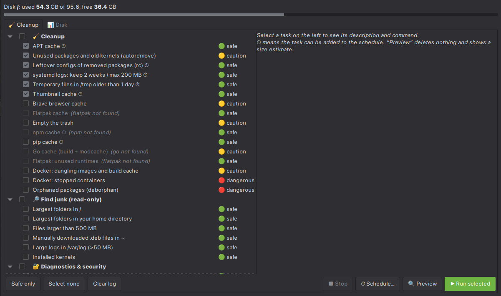

<p align="center">
  
</p>

<h1 align="center">SysCleaner</h1>

<p align="center">GUI cleanup and diagnostics for <b>Linux Mint / Debian / Ubuntu</b> (GTK3 + Python)</p>



Pick tasks with checkboxes, read what each one does and how risky it is, preview the result with size estimates, run it and watch a live log.

## Features

- **System and package cleanup**: APT, Snap, DNF, Pacman and Zypper caches, old kernels, logs, crash reports, core dumps, Flatpak, thumbnails, trash.
- **Browsers**: Firefox, Chrome, Chromium, Edge, Brave, Vivaldi and Opera (regular, Snap and Flatpak installs). Only caches are removed, never profiles, passwords or bookmarks, and a running browser is skipped.
- **Developer tools**: npm, pip, pnpm, Yarn, Cargo, Gradle, Go and Docker.
- **Only what applies to your system is shown**: missing browsers, package managers and tools are hidden.
- **Tasks with explanations and risk levels**: 🟢 safe · 🟡 caution · 🔴 dangerous (dangerous tasks ask for confirmation).
- **Preview (dry-run)**: deletes nothing; shows what would be affected and a size estimate per task and in total.
- **Live log** of every command, plus a "freed space" summary.
- **Disk tab**: ncdu-style browser with a scan progress bar; double-click to drill down, bars show the share of the parent folder, optional scan as root.
- **Scheduling** via systemd timer (daily / weekly / monthly); logs: `journalctl -u syscleaner`.
- **Tasks in YAML**: add your own without changing the code.
- **One password prompt** for all root tasks (polkit / `pkexec`).
- **Follows your system**: light/dark theme and language (English and Russian included).
- **Headless / CLI mode** for scripts and the scheduler.

## Install

Download the latest `.deb` or `.AppImage` from the [Releases page](https://github.com/agteamdev/syscleaner/releases/latest).

```bash
# .deb (Linux Mint / Debian / Ubuntu)
sudo apt install ./syscleaner_*_all.deb

# AppImage (any distro with python3-gi and GTK3)
chmod +x SysCleaner-*.AppImage && ./SysCleaner-*.AppImage

# from source
git clone https://github.com/agteamdev/syscleaner.git && cd syscleaner
sudo apt install python3-gi gir1.2-gtk-3.0 python3-yaml policykit-1
python3 -m syscleaner
```

> Built for Debian-based systems. The DNF, Pacman and Zypper tasks are included but not yet tested on those distributions.
>
> The AppImage uses the system `python3-gi` / GTK3 (preinstalled on Mint, Ubuntu and Debian desktops).
> If you enable the schedule from an AppImage, don't move the file afterwards: the timer points to its path.

## Usage

Start **SysCleaner** from the application menu, or from a terminal:

```bash
syscleaner                                           # GUI
syscleaner --list                                    # list tasks
syscleaner --headless --dry-run --tasks tmp,thumbs   # preview without a GUI
sudo syscleaner --headless --tasks apt_clean,tmp --user "$USER"
```

## Custom tasks (YAML)

Built-in tasks live in `syscleaner/data/tasks.yaml`. Add yours to `~/.config/syscleaner/tasks.d/*.yaml`:

```yaml
groups:
  - {id: mine, title: "⭐ Mine"}
tasks:
  - id: my_cache
    group: mine                      # a group id
    title: "My app cache"
    desc: What it does and what it risks
    cmd: rm -rf ~/.cache/myapp/*     # with root: true write it without sudo
    risk: safe                       # safe | caution | danger
    estimate: sz ~/.cache/myapp      # prints bytes; sz = total size of paths
    preview: ls -la ~/.cache/myapp | head
    schedule: true                   # may be scheduled (never for danger)
  - id: brave                        # hide a built-in task
    disabled: true
```

Other fields: `root`, `default`, `requires` (a program that must exist), `requires_path` (folders that must exist, `~` and `*` allowed) and `hide_missing` (hide the task instead of greying it out when those are missing). YAML errors are shown as warnings in the log.

## Language and theme

- **Theme**: SysCleaner is a plain GTK3 app, so it uses your current system theme (light or dark).
- **Language**: detected from `LANGUAGE` / `LC_ALL` / `LANG`; force one with `SYSCLEANER_LANG=en syscleaner`.
- **Add a language**: copy `syscleaner/data/i18n/ru.yaml` to `<lang>.yaml`, translate the values (keys stay in English) and run `python3 tools/check_i18n.py`.

## Build from source

```bash
make check      # compile + validate YAML + check translations
make deb        # dist/syscleaner_<version>_all.deb
make appimage   # dist/SysCleaner-<version>-x86_64.AppImage
```

## Safety

Deliberately **not** included: `rm -rf /tmp/*`, `rm -rf ~/.cache/*`, `docker system prune -a --volumes`, manual kernel removal and log truncation. Dangerous tasks are never scheduled.

## License

MIT
